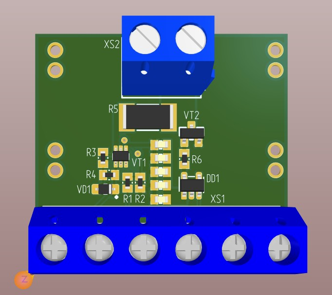
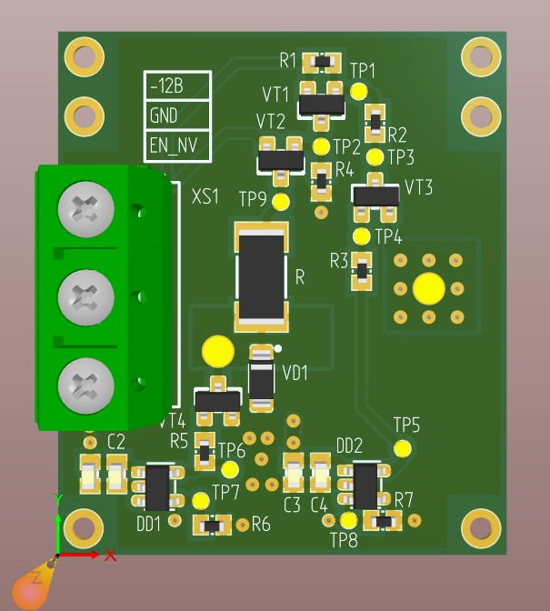

# Модуль имитации пассивных и активных датчиков и дискретного выхода

## 1. Описание

Модуль предназначен для имитации работы активных и пассивных датчиков, а также для формирования дискретного выходного сигнала. Устройство может использоваться для тестирования, отладки и проверки оборудования, работающего с датчиками и дискретными входами.

Управление модулем осуществляется через интерфейс **USB CDC** (виртуальный последовательный порт).

## 2. Возможности

- **Имитация активного датчика** — отключение подтяжек к напряжению `+24 В` и отрицательному напряжению.
- **Имитация пассивного датчика** — включение подтяжек к напряжению `+24 В` и отрицательному напряжению.
- **Формирование дискретного сигнала** — установка логического состояния `HIGH` или `LOW`.
- **Генерация сигнала заданной частоты** — настройка частоты выходного сигнала.
- **Управление подтяжками** — раздельное включение и отключение подтяжек.
- **Получение текущей конфигурации** — чтение настроек выходного сигнала и его состояния.

## 3. Интерфейс взаимодействия USB CDC

USB CDC (Communications Device Class) позволяет обмениваться командами с модулем через виртуальный последовательный порт. Для отправки команд можно использовать терминальную программу или специализированное приложение.

### 3.1. Список команд

| Команда | Аргументы | Описание |
|---|---|---|
| `set_config_output` | `discrete`, `freq` | Настройка режима выходного сигнала и частоты |
| `get_config_output` | — | Получение текущей конфигурации выхода |
| `set_freq` | `0 - 10000` | Установка частоты выходного сигнала, Гц |
| `get_freq` | — | Получение текущей частоты |
| `set_state_output` | `high`, `low` | Установка состояния дискретного выхода |
| `get_state_output` | — | Получение текущего состояния выхода |
| `enable_pull_up` | — | Включение подтяжки к `+24 В` |
| `disable_pull_up` | — | Отключение подтяжки к `+24 В` |
| `enable_nv` | — | Включение подтяжки к отрицательному напряжению |
| `disable_nv` | — | Отключение подтяжки к отрицательному напряжению |
| `set_active_sensor` | — | Настройка режима имитации активного датчика |
| `set_passive_sensor` | — | Настройка режима имитации пассивного датчика |
| `help` | — | Вывод справки по доступным командам |

### 3.2. Режим выходного сигнала

Команда `set_config_output` предназначена для выбора режима работы выхода.

Предусмотрены следующие варианты:

- `discrete` — режим дискретного выхода;
- `freq` — режим формирования сигнала заданной частоты.

Для установки частоты используется команда `set_freq`, а для чтения текущего значения — `get_freq`.

### 3.3. Управление состоянием выхода

Команда `set_state_output` позволяет задать логическое состояние дискретного выхода.

Возможные значения:

- `high` — высокий логический уровень;
- `low` — низкий логический уровень.

Команда `get_state_output` используется для получения текущего состояния выхода.

**Важно:** логические уровни `HIGH` и `LOW` не обязательно соответствуют напряжениям `+24 В` и `0 В` напрямую. Фактическое напряжение зависит от схемы выхода и состояния подтяжек.

### 3.4. Управление подтяжками

Для управления электрическим состоянием выхода предусмотрены две группы команд.

| Команда включения | Команда отключения | Назначение |
|---|---|---|
| `enable_pull_up` | `disable_pull_up` | Управление подтяжкой к `+24 В` |
| `enable_nv` | `disable_nv` | Управление подтяжкой к отрицательному напряжению |

Подтяжка обеспечивает электрическое соединение сигнальной цепи с соответствующим источником напряжения через предусмотренную схемой цепь. Это позволяет моделировать различные варианты подключения датчиков.

### 3.5. Имитация активного и пассивного датчиков

Для быстрой настройки режима работы предусмотрены команды `set_active_sensor` и `set_passive_sensor`.

| Команда | Подтяжка к `+24 В` | Подтяжка к отрицательному напряжению |
|---|---|---|
| `set_active_sensor` | Отключена | Отключена |
| `set_passive_sensor` | Включена | Включена |

**Активный датчик** самостоятельно формирует выходной сигнал, используя собственное питание.

**Пассивный датчик** в контексте данного модуля имитируется с помощью соответствующих цепей подтяжки к внешним потенциалам.

### 3.6. Получение конфигурации и справки

Для чтения текущих настроек используются команды:

- `get_config_output` — получение конфигурации выходного сигнала;
- `get_freq` — получение установленной частоты;
- `get_state_output` — получение состояния дискретного выхода.

Команда `help` предназначена для вывода справки по поддерживаемым командам.

## 4. Подключение к BluePill STM32F303CCT6

| Сигнал модуля | Вывод микроконтроллера | Назначение |
|---|---|---|
| `Enable_3k` | `PB0` | Управление включением подтяжки 3 кОм |
| `Freq` | `PA8` | Сигнал управления частотой / формирования выходного сигнала |
| `Enable_NV` | `PB1` | Управление подтяжкой к отрицательному напряжению |

**Примечание:** назначение сигнала `Freq` приведено предварительно по его названию. Фактическая функция вывода определяется схемой и прошивкой.

Перед подключением убедись, что электрические уровни управляющих сигналов совместимы с микроконтроллером STM32F303CCT6. Напряжения `+24 В` и отрицательное напряжение относятся к цепям модуля и не должны подаваться непосредственно на выводы GPIO микроконтроллера.

## 5. Аппаратная часть

Электрическая принципиальная схема устройства находится в файле:

[**Digital_output_Э3.pdf**](./Hardware/Digital_output_Э3.pdf)

### 5.1. Общий вид модуля

*Рисунок 1 — Общий вид модуля.*

### 5.2. Общий вид расширения к модулю

*Рисунок 2 — Общий вид расширения к модулю.*

## 6. Примечания

- Перед подключением оборудования проверь соответствие режима имитации типу подключаемого датчика.
- Учитывай, что цепи подтяжки к `+24 В` и отрицательному напряжению могут влиять на электрическое состояние выхода.
- Допустимые частоты, электрические параметры выхода и особенности переключения режимов определяются аппаратной реализацией.
- Точные форматы команд и ответов USB CDC следует уточнять по реализации прошивки.

